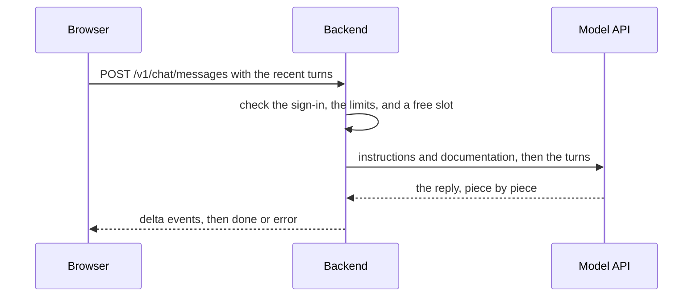
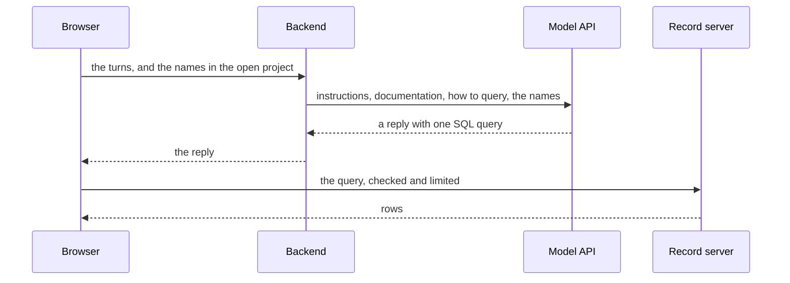

<!--
SPDX-FileCopyrightText: Manta contributors
SPDX-License-Identifier: CC-BY-4.0
-->

# Chat

The chat ("Ask Rai") answers questions from Manta's documentation, and the model behind it can read and change nothing in Manta.
This page explains that decision, where the documentation comes from, why the backend stores no conversation, and what limits a reply.
[Contributing: Backend](../contributing/backend.md#chat) shows how to run the chat with a local model and lists its settings.

## What the model can reach

The backend sends the model text and receives text.
The model has no functions to call (tools), no access to the database, and no view of a user's runs or of the values in their data.
The backend's outbound connection to the model API is the one new privilege in the system.

The reason is an instruction hidden in a question (prompt injection).
No instruction reliably stops a model from following the text it reads.
Asked to ignore its instructions and write a poem, the default local model wrote the poem.
So the design assumes that the model does whatever its input states, and limits what follows from that.
A user who subverts the model changes only the text in their own drawer.

The alternative is a model with tools that read runs, logs, or results on the server.
Such a chat can read a user's runs and logs, and can state a number from their data, which this one cannot.
Every tool is then something an injected instruction can call with the user's identity, so every tool needs its own checks.
For a first version, a chat that cannot act is better than a chat that depends on those checks.

## The path of a question

The browser sends the recent turns of the conversation to `POST /v1/chat/messages`.
The backend checks the request, puts its own instructions and the documentation in front, and forwards the result to the model API.

The backend passes the reply on as a response the browser reads piece by piece (server-sent events).
`delta` events contain the text, and one `done` or `error` event ends the reply.
The [REST API reference](../reference/backend/rest-api.md) lists both chat routes.

Once a response has started, its status code cannot change.
So the backend refuses a request before the stream starts wherever it can, with an ordinary status code.
When the model fails part-way, the backend ends the stream with an `error` event that states only the kind of failure.

## Conversations

The backend stores no conversation.
A model has no memory between requests, so the browser resends the turns it wants remembered with every question.
Each turn has a role: `user` for what the person wrote, and `assistant` for an earlier reply.
The backend accepts only those two roles, and writes the model's instructions (the `system` message) itself.

A client can therefore send a history that the model never wrote.
That is acceptable here, because a forged history reaches as far as a forged question does: the sender's own reply.
The alternative is a table of conversations, which holds free text that users typed and needs a retention period and a deletion process.
Without one, a conversation ends when the user closes the drawer.

## Documentation in the prompt

The backend reads the configured documentation pages at startup and puts them whole into the model's instructions.
The default is the four user guide pages, which `llama3.2:3b` counts as about 3,800 tokens.
The backend refuses to start when a page is missing or the pages are longer than `CHAT_DOCS_MAX_CHARS`.
The second check exists because Ollama cuts off a prompt that is too long for the model, without an error.

The alternative is to search the documentation for each question and send only the passages found (retrieval).
Retrieval needs an index, a search step, and a way to keep both current.
It suits a body of text that is too large for one prompt, and the user guide is not.

Sending the same text with every question has a second benefit: a model server can reuse its work on a prompt it has already read.
On a laptop with an M2 processor and 8 GB of memory, the first reply started after 12 to 16 seconds.
Later replies started after 1 to 4 seconds.

The cost is that the chat knows only the listed pages, and a longer list needs a model that can read more at once.

## Limits

A reply costs model time, so the backend bounds every request before and during the reply.

- Only a signed-in user can ask.
- A request has a maximum number of turns, a maximum length for each turn, and a maximum total length.
- A reply has a maximum length and a maximum duration.
- The backend writes at most `CHAT_MAX_CONCURRENT` replies at once, and answers `429` to a request beyond that.

Together these limits bound what the chat can spend at any moment: the number of slots, each with one reply of the maximum duration.
They do not share that capacity fairly.
Manta has no limit for each user, so one user can occupy every slot.
The backend counts the slots within its own process, which is correct while Manta runs one backend process.

The length limits come from the text a model can read at once (its context window).
The defaults fit `llama3.2:3b` with a window of 8,192 tokens: the documentation, the turns, and the reply share it.
A model with a larger window allows larger values.

## Streaming in a synchronous backend

Every route of the backend is synchronous, and the chat route is too.
The route is a generator, so FastAPI runs it on a worker thread and sends each event when the generator yields it.
A reply in progress therefore occupies one worker thread, and the limit on concurrent replies keeps that number small.

An asynchronous route would free the thread and would notice a closed connection sooner.
It would also be the only asynchronous code in the backend, with its own HTTP client and its own way of testing.
Here the synchronous route is better, because the slot limit already bounds the threads in use.
When a user stops a reply, its thread ends at the model's next piece of text, or at the timeout.

The route hands its database connection back before the reply starts, because a reply can last as long as the timeout.

## The model API

The backend sends requests in the OpenAI chat completions format, over plain HTTP.
Ollama, vLLM, and most hosted providers accept that format, so a change of provider is a change of three settings.
A provider's own SDK would tie the code to that provider.
A library that wraps many providers would add a large dependency for the sake of one request.

## Plain-text replies

The drawer shows a reply as plain text.
A reply is untrusted input to the page, and plain text cannot contain a link, an image, or a script.
The instructions ask the model for plain text.
The backend also removes the bold markers from the documentation, because a model repeats the formatting it reads.

## Questions about a project's data

With `CHAT_SQL_ENABLED`, the model can answer a question about the open project's data with one SQL query.
The browser runs the query and shows the rows as a table.
The backend never runs the query, and the rows never go to the model.

The model therefore still has no tools.
A query runs with the access the user's browser already has to the record server, so a subverted model can read nothing the user cannot.
The alternative is for the backend to run the query, which makes the model's text an input to a server that holds every project.

The browser sends the names of the project's component types, carriers, and attributes with a question.
The backend checks each name against a short pattern and writes them into the instructions itself.
A forged name reaches as far as a forged history does: the sender's own reply.

Before the browser runs a query, it checks that the reply holds one statement that starts as a query.
It then points each view name at the scenario on screen, wraps the query so that at most 200 rows return, and sends it to the record server.
The record server refuses everything but reads.
The browser never runs the query in its own database, which can attach other databases and read from URLs.

When a query fails, the browser sends the error to the model once and runs the corrected query.
That is the only result the model receives.
Sending the rows would let the model state numbers, and would send a project's data to the model provider.

The cost of this design is a query that runs and answers a different question.
The model sees names and no values, so nothing tells it that a query read the wrong attribute.
On 14 questions about an example project, the default local model wrote 8 correct queries, 4 that ran with a wrong result, and 2 that failed.
The drawer therefore shows the query with every table.

Three limits come from the record server, which is temporary.
Every user of a deployment shares one token for it, so a query can read any project's data, as the app's own reads can.
The record server calls its check for reads a proof of concept.
The page has one connection to it without a way to cancel, so a slow query delays the app's own reads.

## What a change has to keep

The design has one guarantee: a subverted model changes only the text that its own user sees.
A change keeps the guarantee while the model has no tools, the backend stores nothing a model wrote, and no reply reaches another user.
It also has to keep a model's query out of the backend and out of the browser's own database.
A change that adds one of those needs the checks this design avoids.
