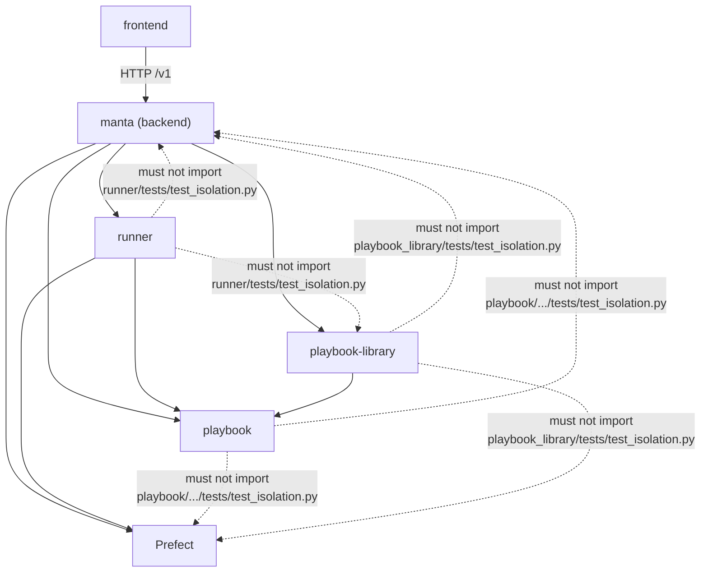
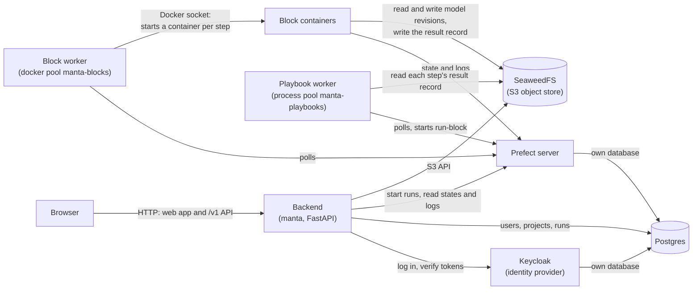
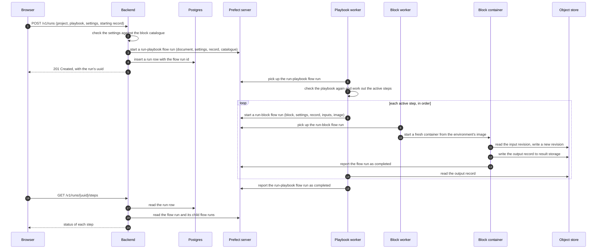

<!--
SPDX-FileCopyrightText: Manta contributors
SPDX-License-Identifier: CC-BY-4.0
-->

# Architecture

A project in Manta moves from sign-in through modelling, running, inspecting and reporting, as the [user guide](../user-guide/index.md) describes.
A playbook run is the Run stage of that path.
The backend starts it for a project, and the run saves its results as revisions in a data record.

Manta keeps its modelling code apart from the code that schedules and runs it.
So you can write and test a block without any of Manta's services.
This page covers the packages and their dependencies, the running services, one playbook run, and where each kind of data is kept.
It assumes you know what a block and a playbook are, which are defined in the [user guide concepts page](../user-guide/concepts.md).

## The packages and their dependencies

Manta is a monorepo of five packages.

| Package            | Directory           | What it is                                                                                   |
| ------------------ | ------------------- | -------------------------------------------------------------------------------------------- |
| `manta`            | `backend/`          | The FastAPI web service: REST API, authentication, projects and runs.                        |
| frontend           | `frontend/`         | The React web app, built to static files that the backend serves.                            |
| `playbook`         | `playbook/`         | The modelling framework: what a block and a playbook are, how to check and run a playbook.  |
| `playbook-library` | `playbook-library/` | The blocks and playbooks Manta ships, built on PyPSA.                                        |
| `runner`           | `runner/`           | The Prefect flows that run a playbook and run each of its blocks in a container.             |

The arrows below show which package imports which.
A dotted arrow marks an import that is forbidden, and the test named on it fails if the import appears.

The solid arrows point from a package to what it imports.
The backend imports all three Python packages and Prefect, and `runner` imports `playbook` and Prefect.
`playbook-library` imports only `playbook` among Manta's packages.
The frontend imports none of them and reaches the backend over HTTP.

Each dotted arrow is a rule, checked by an import scan in the test file written on it:

- `runner` must not import `manta` or `playbook_library`, which [`runner/tests/test_isolation.py`](https://github.com/manta-plan/manta/blob/main/runner/tests/test_isolation.py) checks.
- `playbook` must not import `manta`, Prefect, Docker, Kubernetes, Celery or Airflow, which [`playbook/src/playbook/tests/test_isolation.py`](https://github.com/manta-plan/manta/blob/main/playbook/src/playbook/tests/test_isolation.py) checks.
- `playbook-library` must not import the same set, which [`playbook-library/src/playbook_library/tests/test_isolation.py`](https://github.com/manta-plan/manta/blob/main/playbook-library/src/playbook_library/tests/test_isolation.py) checks.
- Inside `playbook`, the `playbook.blocks` layer must not import `playbook.playbooks`, which the `playbook` test file above also checks.

These rules let `playbook` and `playbook-library` work outside Manta.
A modeller runs a block as a plain method call, and tests it with no Prefect server or Docker daemon.
What schedules that call plugs in from outside through the `BlockRunner` protocol in `playbook.playbooks`, which `runner` implements as `PrefectBlockRunner`.
The `runner` rule keeps it reusable by any block library, because depending on one library would tie the runtime to it.
The `playbook.blocks` rule means a block library depends on the block layer alone.

The backend's import of `playbook-library` is the one edge that goes against this design.
The backend reads the shipped playbooks and the block catalogue from it directly, and a comment in `backend/pyproject.toml` marks that dependency as a shortcut.

## The running system

A running Manta is the backend process plus the services in [`docker/compose-dev-services.yaml`](https://github.com/manta-plan/manta/blob/main/docker/compose-dev-services.yaml).
The diagram shows the long-lived parts and the connections between them.

The browser talks only to the backend, which serves both the built web app and the `/v1` REST API on one port.
The backend logs a user in through Keycloak and checks each request's token against it.
Postgres holds three databases: the backend's own, Keycloak's and Prefect's.

Two Prefect workers run playbooks, and neither imports a block.
The playbook worker drains the process pool `manta-playbooks` and runs the `run-playbook` flow, which walks the playbook and starts one `run-block` flow run per step.
The block worker drains the docker pool `manta-blocks`, and starts a fresh container for each `run-block` flow run through the host's Docker socket.
That container runs from the image of the environment the block declares, which contains `playbook-library`, the block's dependencies, Prefect and `runner`.

A playbook run holds a process for its whole length, because it waits on every step.
Running it on a long-lived process worker, instead of in a container per run, means an evicted container cannot take the run down.
It also means a playbook run continues while the backend restarts, because the backend is not in the execution path.

Two one-shot services run when the stack starts and then exit.
`block-image-builder-pypsa` builds the block image for the `pypsa` environment.
`playbooks-provision` runs `python -m runner.deploy`, which creates both work pools, registers the two deployments, and points Prefect's result storage at the object store.

## A run from click to result

One playbook run passes through the backend, Prefect, both workers and one container per step.

The numbers in the diagram give the order of the calls.
The backend checks the settings before it starts anything.
It refuses a run that cannot work with HTTP 422 and a list of every issue.
It then asks Prefect for a `run-playbook` flow run without waiting for it, and records the flow run's id in a new `runs` row.

The playbook worker runs `execute_playbook` from `playbook` with a `PrefectBlockRunner`.
`execute_playbook` checks the playbook a second time against the catalogue it was handed, because the worker cannot import a block library.
For each active step, `PrefectBlockRunner` starts a `run-block` flow run and waits for it.
It passes the image of the block's environment as a job variable, so the block worker knows which image to start.

Inside the container, `run-block` loads the block library, looks the block up by name and runs it on the input record.
The block reads the model from the record's revision and writes its result as a new revision in the same store.
The returned record, a store URL and a revision uuid, goes to Prefect's result storage on the object store.
The playbook worker reads it back as the next step's input.
Each `run-block` flow run is a child of its `run-playbook` flow run.
So the backend finds a run's steps by asking Prefect for the children of one flow run.

## Where data lives

Each kind of data has one home, and Prefect holds pointers to model data but never the data itself.

| Store              | What it contains                                                                                                                                                  |
| ------------------ | ----------------------------------------------------------------------------------------------------------------------------------------------------------------- |
| Postgres           | The backend's `users`, `projects` and `runs` tables, plus Keycloak's and Prefect's own databases. A `runs` row has the project, the playbook name and the Prefect flow run id. |
| Object store       | The versioned stores of model data (datarecord stores), where every block writes a new revision of the model. Prefect's result storage, under `prefect-results/`. The folder `<project uuid>/runs/<run uuid>/output/`, where the backend lists a run's output files. |
| Prefect            | Each flow run's parameters, state and logs. The parameters of a `run-playbook` flow run are the playbook document, the settings, the starting record and the catalogue. |

A record is a pointer, never the model itself: a store URL and the uuid of one revision in that store.
The store URL is either a local directory or an `s3://` address.
Model data never passes through Prefect or the workers, because only records cross between processes.

No block writes to a run's output folder, so the models a run produces are found only as revisions in the datarecord store.

The `runs` table does not contain a run's settings or status.
The backend reads both back from the Prefect flow run each time a client asks for a run.

## Where to read next

The package READMEs go into each package in detail:

- [`playbook/README.md`](https://github.com/manta-plan/manta/blob/main/playbook/README.md) explains how to write a block and a playbook, and how a playbook is checked.
- [`playbook-library/README.md`](https://github.com/manta-plan/manta/blob/main/playbook-library/README.md) lists the shipped blocks and playbooks and their environments.
- [`runner/README.md`](https://github.com/manta-plan/manta/blob/main/runner/README.md) explains the two flows, the work pools and the block images.
- [`docker/README.md`](https://github.com/manta-plan/manta/blob/main/docker/README.md) describes each local service.
- [`CONTRIBUTING.md`](https://github.com/manta-plan/manta/blob/main/CONTRIBUTING.md) sets out the backend's layers and the coding standards.

The reference pages list the interfaces:

- [`playbook` API](../reference/playbook/api.md)
- [`runner` API](../reference/runner/api.md)
- [REST API](../reference/backend/rest-api.md)
