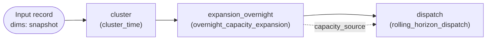

<!--
SPDX-FileCopyrightText: Manta contributors
SPDX-License-Identifier: CC-BY-4.0
-->

# Blocks, playbooks and the catalogue

Manta describes every block as data.
So a process that cannot import a block can still build, check and dispatch a playbook that uses it.
This page explains that decision and the rest of the design of the `playbook` package that follows from it.
[Playbooks and blocks](../user-guide/playbooks.md) introduces the two terms from a modeller's side.
The [playbook README](https://github.com/manta-plan/manta/blob/main/playbook/README.md) shows how to write a block and a playbook.

A block is one unit of work in an energy model workflow, such as aggregating a time series.
A playbook is blocks chained together into something you can run.
A step is one block, or one nested playbook, in a playbook.
The catalogue is the description of every block: its name, its settings as JSON schema and its dimensions.

## Two layers

The `playbook` package has two layers.
`playbook.blocks` defines a block and everything needed to describe one without running it.
`playbook.playbooks` chains blocks into playbooks, checks them and runs them.
The block layer never imports the playbook layer, so a block library depends on the block layer alone.
[Architecture](architecture.md#the-packages-and-their-dependencies) lists the test that checks this rule.

## A block describes itself on its class

A block is a subclass of [`MantaBlock`](../reference/playbook/api.md), with its work in a `run` method.
Everything else a block states about itself is a class attribute.
These attributes set its environment, its settings model, its dimensions, the settings another block fills in, and the results it offers.
Tools read these attributes without calling `run`, and the catalogue holds them without importing the class at all.

`MantaBlock` checks a new subclass as soon as Python creates it.
Every setting named in `INPUTS` has to hold a record and have a default.
So a block always runs with nothing wired to it, and a mistake in its definition fails on import rather than in a run.

Each step gets a fresh instance of its block.
So a block carries no state from one run to the next.

## A record is a pointer

A block reads a `DataRecord` and returns a new one.
A record is a store URL and the uuid of one revision in that store, never the model itself.
The store is a local directory or an `s3://` address.

A record crosses processes and machines, which a loaded model could not survive.
So every record crosses a boundary as plain JSON, `{"url": ..., "uuid": ...}`.
Each block writes its result as a new revision in the store it read from.
So the revisions of one store are the history of a run.

## Dimensions

Each block declares the dimensions it requires, adds and removes, such as `snapshot` or `period`.
`playbook` folds these declarations along a playbook's steps, starting from the dimensions the playbook declares for its input in `initial_data`.
It works out which dimensions the data has before each step.
A step that needs a dimension an earlier step removed is a problem found before anything runs, and the message names the step.

The fold uses only the declarations, so it works for blocks the checking process cannot import.
A playbook has to declare its input's dimensions because a record does not yet describe the data it points at.

## Blocks are found by name

A playbook names its blocks as strings, such as `cluster_time`.
A name is all a playbook needs, because no single Python environment can import every block.

A block library registers each block with `register_lazy`, as a name and the module that holds it.
Importing the library then makes every name known without importing a single block module.
A process learns which libraries to import from the `MANTA_BLOCK_SOURCES` environment variable.
So `playbook_library` imports in an environment with no PyPSA.
Its `dev` test environment has no PyPSA on purpose, and its tests passing there show that a block's dependencies stay the block's own.

## The catalogue

Each environment describes the blocks it can import.
`python -m playbook.blocks <library>` prints a catalogue for one environment as JSON.
For each block, the catalogue has its name, environment, one-line summary, dimensions, inputs and outputs, and its settings as JSON schema.
`merge_catalogues` merges the catalogues of several environments into one description of every block.

The JSON schema marks each setting that another block fills in with `x-manta-input`.
A form built from the schema skips these settings, because they are connections in the playbook, not values a user types.

A catalogue has a `catalogue_version` integer, raised by hand when the catalogue's shape changes.
A reader that gets an unfamiliar shape can then tell, rather than misread it.
Nothing in Manta checks the number yet.

A playbook step holds a `BlockSpec`: a block's description from the catalogue, plus the class itself where it can be imported.
Building, checking, drawing and dispatching a playbook need only the description.
Only running a block needs the class, and asking for an unavailable class raises `BlockUnavailableError`, which names the environment the block needs.

`playbook-library` commits its catalogue as `catalogue.json`, generated in its `pypsa` environment.
Its full test suite fails when the committed file no longer matches the blocks.
The backend and `run-playbook` both read this committed catalogue, so neither imports PyPSA.

## How results move between steps

Results move between steps in two ways.
Every step gets the record the previous step returned, which is the main line of a playbook.
A step can also take one earlier step's result into one of its settings, written `${steps.<step>.<output>}`, which is a wire.

The diagram shows part of the `cluster-expand-dispatch` playbook, with each step's name above its block.
The solid arrows are the main line, and the dashed arrow is a wire.
`dispatch` gets the record that `expansion_overnight` returned along the main line.
It also gets the same step's result in its `capacity_source` setting, which gives it the capacities to dispatch against.

Most energy model studies run in a line, so the main line needs no wiring at all.
Wires cover the cases where a later step needs one particular earlier result.

## Settings live in a separate document

A playbook states which steps run.
A separate settings document states how each one runs: one section per step name, plus a `globals` section that every step can read.
One playbook therefore runs in several ways, which is the scenario analysis that Manta exists for.

Each step has its own name, so one block can appear twice with different settings.
`expansion_2030` and `expansion_2040` can be two steps of one block.

## Conditions look only at settings

A `when` condition switches a step on or off from one setting, such as `globals.expansion_mode`.
It never looks at the data.

That restriction makes a playbook checkable before it runs, because the settings alone decide which steps run.
The cost is that a playbook cannot branch on the data, such as "run this step only if the network has more than 100 buses".
[Open questions](open-questions.md#conditions-on-data) records whether that limit should stay.

`Playbook.active` is the one place that works out which steps run.
Checking, dispatching and reporting a run's steps all ask it, so they cannot disagree.
A step that is switched off stays in the playbook, and `GET /v1/runs/{uuid}/steps` reports it as `SKIPPED`.

## Playbooks inside playbooks

A step can be another playbook.
In YAML, the step names it by locator, `playbook: <path>`, or writes it out in place, which suits a browser with no file system.

The inner playbook offers each input it does not wire itself to the outer playbook, as `<step>.<setting>`.
Its settings sit under its step's name, and it inherits the outer `globals` unless it has its own.
Checking a playbook includes its nested playbooks, and a problem inside one is reported with the full path of step names.
A playbook that ends up containing itself is a reported problem, not an endless loop.

`playbook` reads a locator through a `PlaybookLoader`, an interface rather than a file path.
The one loader that exists reads files, and Manta has none that reads its own database yet.
No shipped playbook nests another, and the steps endpoint reports a nested step's status as `UNKNOWN`.

## Checking a playbook

`find_playbook_issues` returns every problem with a playbook at once, and raises nothing.
Each issue names its step and, where one is at fault, the exact setting.
So a user interface can mark the right step and the right field.
The [playbook README](https://github.com/manta-plan/manta/blob/main/playbook/README.md#checking-a-playbook) lists each kind of check.

Without settings, only the checks that hold for any settings run.
They check for unique step names, wires to earlier steps that offer that result, and no playbook inside itself.
Every other check depends on which steps run, and so on the settings.

Where a block can be imported, its own settings model checks its settings.
Where it cannot, its JSON schema from the catalogue does, which catches wrong types and missing or unknown settings.
A rule that a block states in code cannot travel in a schema.
`cluster_time` needs exactly one of `n_hours` and `segments`, so a process without PyPSA cannot check that rule, and the block refuses it when it runs.
[Run lifecycle](run-lifecycle.md#where-a-playbook-is-checked) lists where each check runs.

## What this design costs

The design gives up three things for checking before a run:

- A condition cannot look at the data.
- A block declares `OUTPUTS`, but every block so far returns one result, so wires carry `output` only.
- A playbook declares its input's dimensions, because a record does not describe its own data yet.

With these limits in view, you can judge whether a new block fits the model as it is or needs a change to `playbook`.
A block that needs only settings, a record and declared dimensions fits.
A block that has to decide from the data which step runs next does not fit yet.
