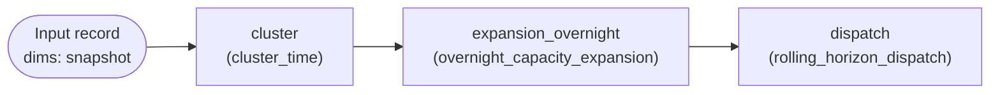

<!--
SPDX-FileCopyrightText: Manta contributors
SPDX-License-Identifier: CC-BY-4.0
-->

# Blocks, playbooks and the catalogue

Manta describes every block as data.
So a process that cannot import a block can still build, check and dispatch a playbook that uses it.
This page explains that decision and the rest of the design of the `playbook` package that follows from it.
[Playbooks and blocks](../user-guide/playbooks.md) introduces the two terms from a modeller's side.
To write a block, see the [playbook README](https://github.com/manta-plan/manta/blob/main/playbook/README.md).
For every key of a playbook, see the [playbook syntax](../reference/playbook/syntax.md).

A block is one unit of work in an energy model workflow, such as aggregating a time series.
A playbook is blocks chained together into something you can run.
A step is one block, or one nested playbook, in a playbook.
The catalogue is the description of every block: its name, its settings as JSON schema and its dimensions.

## Two layers

The `playbook` package has two layers.
`playbook.blocks` defines a block and everything needed to describe one without running it.
`playbook.playbooks` chains blocks into playbooks, checks them and runs them.
The block layer never imports the playbook layer, so a block library depends on the block layer alone.
[Architecture](architecture.md#the-packages-and-their-dependencies) lists the test that checks this rule.

## A block describes itself on its class

A block is a subclass of [`MantaBlock`](../reference/playbook/api.md), with its work in a `run` method.
Everything else a block states about itself is a class attribute.
These attributes set its environment, its settings model, and its dimensions.
Tools read these attributes without calling `run`, and the catalogue holds them without importing the class at all.

`MantaBlock` checks a new subclass as soon as Python creates it.
The subclass has to set its environment in `ENV` and its settings model in `CONFIG`.
So a block that leaves out either fails when Python imports it, not partway through a run.

Each step gets a fresh instance of its block.
So a block carries no state from one run to the next.

## A record is a pointer

A block reads a `DataRecord` and returns a new one.
A record is a store URL and the uuid of one revision in that store, never the model itself.
The store is a local directory or an `s3://` address.

A record crosses processes and machines, which a loaded model could not survive.
So every record crosses a boundary as plain JSON, `{"url": ..., "uuid": ...}`.
Each block writes its result as a new revision in the store it read from.
So the revisions of one store are the history of a run.

## Dimensions

Each block declares the dimensions it requires, adds and removes, such as `snapshot` or `period`.
Starting from the dimensions the playbook lists in `initial_data`, `playbook` folds these declarations along the steps that run with the given input values.
It works out which dimensions the data has before each step.
If a step needs a dimension that the data does not have at that point, `playbook` reports the problem, with the step's path, before anything runs.

The fold uses only the declarations, so it works for blocks the checking process cannot import.
A playbook has to list its starting dimensions, because a record does not yet describe the data it points at.
If the playbook lists a dimension that the record does not populate, the problem shows only when a block that needs the dimension runs.

## Blocks are found by name

A playbook names its blocks as strings, such as `cluster_time`.
A name is all a playbook needs, because no single Python environment can import every block.

A block library registers each block with `register_lazy`, as a name and the module that holds it.
Importing the library then makes every name known without importing a single block module.
A process learns which libraries to import from the `MANTA_BLOCK_SOURCES` environment variable.
So `playbook_library` imports in an environment with no PyPSA.
Its `dev` test environment has no PyPSA on purpose, and its tests passing there show that a block's dependencies stay the block's own.

## The catalogue

Each environment describes the blocks it can import.
`python -m playbook.blocks <library>` prints a catalogue for one environment as JSON.
For each block, the catalogue has its name, environment, one-line summary, dimensions, and settings as JSON schema.
`merge_catalogues` merges the catalogues of several environments into one description of every block.

A catalogue has a `catalogue_version` integer, raised by hand when the catalogue's shape changes.
A reader that gets an unfamiliar shape can then tell, rather than misread it.
Nothing in Manta checks the number yet.

A playbook step holds a `BlockSpec`: a block's description from the catalogue, plus the class itself where it can be imported.
Building, checking, drawing and dispatching a playbook need only the description.
Only running a block needs the class, and asking for an unavailable class raises `BlockUnavailableError`, which names the environment the block needs.

`playbook-library` commits its catalogue as `catalogue.json`, generated in its `pypsa` environment.
Its full test suite fails when the committed file no longer matches the blocks.
The backend and `run-playbook` both read this committed catalogue, so neither imports PyPSA.

## How results move between steps

Every step gets the record of the step above it that ran.

The diagram shows the steps of the `cluster-expand-dispatch` playbook that run when `expansion_mode` is `overnight`, with each step's id above its block.
`dispatch` gets the record that `expansion_overnight` returned, which contains the optimised capacities to dispatch against.

A playbook has no other way to pass a result between steps.
It cannot pass the record of one step into the settings of a later step.
We leave that out because most energy model studies run in a line, and a line of records covers them.

## The playbook format

The keys of a playbook loosely follow the [workflow syntax of GitHub Actions](https://docs.github.com/en/actions/reference/workflows-and-actions/workflow-syntax).
We chose this over designing a YAML workflow syntax of our own from nothing.
`inputs`, `steps`, `id`, `with`, `if`, and `${{ }}` expressions work in a playbook much as they do in a workflow.
So anyone who has written a workflow can read a playbook.

The match is loose, because a playbook chains blocks and a workflow runs commands.
A playbook step has a `block` or a `playbook` key, where a workflow step has `uses` or `run`.
A playbook has no `on` and no `jobs`, and an expression can refer only to `inputs`.
A playbook is not a workflow, and GitHub Actions cannot run one.

## Settings and inputs

The author of a playbook fixes a setting in a step's `with`, and a run can give every other setting of the block.
A setting in `with` is a value written in place, or an expression that refers to an input.
A run gives the other settings by step id, and [`apply_settings`](../reference/playbook/syntax.md#settings-of-a-run) merges them into the `with` of each step before `playbook` checks the playbook.
`apply_settings` refuses a setting that `with` already sets, so a run cannot undo what the author fixed.

An input is a value that a user sets once for a whole run, with a type and an optional default.
A step's `with` and `if` refer to an input through a `${{ inputs.<name> }}` expression.
So one input can switch steps on and off, which is the scenario analysis that Manta exists for.
One input can also set the same value on several steps.
In `cluster-expand-dispatch`, the input `solver_name` sets the solver of every optimisation step.

The alternative we rejected is to let a run reach a block only through inputs.
The author would then have to declare an input for every setting that any user might want to change.
A block already describes all its settings in the catalogue, so declaring them again as inputs adds nothing for the user.
Instead, the author decides only what cannot change, and a user keeps access to every other setting of a block.

Each step has its own id, so one block can appear twice with different settings.
`expansion_2030` and `expansion_2040` can be two steps of one block.

## Conditions look only at inputs

With an `if` condition, such as `${{ inputs.expansion_mode == 'myopic' }}`, a step runs only when the condition on the inputs is true.
The condition cannot refer to the data.

That restriction makes a playbook checkable before it runs, because the input values alone set which steps run.
The cost is that a playbook cannot branch on the data, such as "run this step only if the network has more than 100 buses".
[Open questions](open-questions.md#conditions-on-data) records whether that limit should stay.

`plan`, in `playbook.playbooks`, is the one function that works out which steps run and with which settings.
Checking, dispatching, and reporting a run's steps all use it, so they cannot disagree.
A step that is switched off stays in the playbook, and `GET /v1/runs/{uuid}/steps` reports it as `SKIPPED`.

## Playbooks inside playbooks

A step can be another playbook.
In YAML, the step's `playbook` key is a locator, `playbook: <locator>`, or the whole playbook written out in place.
A playbook written out in place suits a browser with no file system.

The step's `with` sets the inner playbook's inputs.
With `inputs: inherit`, each input of the inner playbook that `with` does not set becomes an input of the outer playbook.
When `playbook` checks a playbook, it checks the nested playbooks too, and reports a problem inside one with the full path of step ids.
`playbook` refuses to read a playbook document that nests itself, directly or through another playbook, so a run cannot loop for ever.

`playbook` reads a locator through a `PlaybookLoader`, an interface rather than a file path.
The one loader that exists reads files, and Manta has none that reads its own database yet.
No shipped playbook nests another, and the steps endpoint reports a nested step's status as `UNKNOWN`.

## Checking a playbook

`find_playbook_issues` returns every problem with a playbook at once, and raises nothing.
Each issue has the path of its step and, where one is at fault, the path of the exact input or setting.
So a user interface can mark the right step and the right field.
For each kind of check, see the [playbook syntax](../reference/playbook/syntax.md#checking-a-playbook).

When `find_playbook_issues` gets no input values, it runs only the checks that hold for any values.
These checks find:

- step ids that clash
- inherited inputs whose names clash
- expressions that refer to an input that does not exist
- a nested playbook given an input it does not declare
- a playbook inside itself

Every other check depends on which steps run, and so on the input values.

Where a block can be imported, its own settings model checks its settings.
Where it cannot, its JSON schema from the catalogue does, which catches wrong types and missing or unknown settings.
A rule that a block states in code cannot travel in a schema.
`cluster_time` needs exactly one of `n_hours` and `segments`, so a process without PyPSA cannot check that rule, and the block refuses it when it runs.
[Run lifecycle](run-lifecycle.md#where-a-playbook-is-checked) lists where each check runs.

## What this design costs

The design gives up three things for checking before a run:

- A condition cannot look at the data.
- A playbook cannot pass one step's result into another step's settings.
- A playbook lists the dimensions of its starting data in `initial_data`, because a record does not describe its own data yet.

With these limits in view, you can judge whether a new block fits the model as it is or needs a change to `playbook`.
A block that needs only settings, the record of the step above it, and declared dimensions fits.
A block that has to decide from the data which step runs next does not fit yet.
