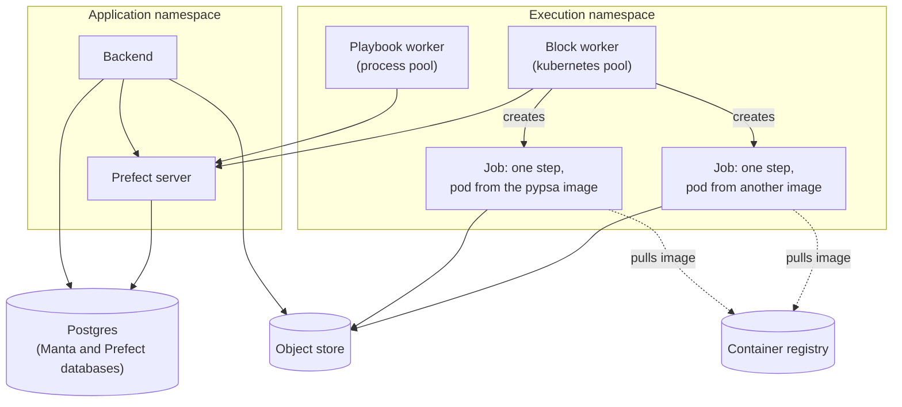

<!--
SPDX-FileCopyrightText: Manta contributors
SPDX-License-Identifier: CC-BY-4.0
-->

# Deployment topology

Manta's design runs the same code on a developer's machine, on a cloud service and inside a client's own Kubernetes cluster.
This page explains what stays the same between those targets, what differs, and how each change to a running system is rolled out.
Today only the local Docker Compose stack exists, and the [Installation](../installation/index.md) pages show how to start it.

Two things differ between targets.
One is how a block environment becomes something a worker can start.
The other is what creates the work pools, the workers and the deployments, which this page calls the apply layer.
The flows, the backend and the blocks stay the same on every target.

## Environments

A block names the environment it needs, such as `pypsa`.
That one name ties together the parts that make up an environment:

| Part                     | Where the name appears                                                      |
| ------------------------ | --------------------------------------------------------------------------- |
| The block                | Its `ENV` class attribute, `ENV = "pypsa"`                                   |
| The pixi environment     | `[environments]` in `playbook-library/pixi.toml`                            |
| The block image          | The `ENV_NAME` build argument of `docker/block-image.Dockerfile`, and the image tag, `block-prefect-runtime:pypsa` |
| The image mapping        | An entry of `MANTA_ENV_IMAGES`, `pypsa=block-prefect-runtime:pypsa`         |

`runner.config.exec_image` is the one place that turns an environment name into an image.
`PrefectBlockRunner` passes that image with each `run-block` flow run, so one docker work pool serves every environment.

The number of environments changes rarely, because each one is a set of dependencies such as a modelling framework.
Playbooks are user content and change all the time.
So Manta scales its infrastructure with the number of environments, never with the number of playbooks or users.
With one pool for all environments, a new environment needs a new image and an entry in the mapping.
It needs no new pool and no new worker.
The playbook worker reads the mapping when it dispatches a step, so it needs the new entry too.

## Two images

A block image is built in two stages, in one Dockerfile.
The `bare` stage holds `playbook-library` and the dependencies of one environment, with no Prefect.
It is the environment a block author tests against.
The `block-prefect-runtime` stage adds Prefect and `runner` on top, and is the image a step runs in.

A block image needs Prefect because a Prefect worker never marks a flow run as completed itself.
The Prefect engine inside the container reports the final state and the result.
Without Prefect, a container would run its block, exit cleanly, and leave the flow run `PENDING`.
The [runner README](https://github.com/manta-plan/manta/blob/main/runner/README.md#why-block-containers-hold-prefect-and-why-the-bare-image-still-exists) gives the detail.

The `runner` image, built from `docker/runner-image.Dockerfile`, runs the provisioning step and both workers.
It contains `runner` and `playbook` but no block library.

## The local stack

The local stack is Docker Compose, from `docker/compose-dev-services.yaml`.
[Architecture](architecture.md#the-running-system) draws its services and the connections between them.

The stack is its own apply layer.
The `playbooks-provision` service creates the pools and deployments, and the workers are two Compose services.
Neither has a restart policy, so a crashed service stays visible rather than restarting quietly.
The backend runs outside Compose, as a process on the host.

The block worker starts each block container through the host's Docker socket.
Those containers are siblings of the Compose services, joined to the stack's network so that they reach the object store.
Access to the Docker socket gives control of the host's Docker, which is acceptable for a development stack only.

The backend's integration tests start the same services from `docker/compose-test-services.yaml`.
That file includes the development stack as it is, under its own Compose project name and with random host ports.
So a test run never clashes with a development stack that is already running.

The workers, not the backend, are started by whatever manages the infrastructure.
Then the backend and the workers can each restart without the other noticing.

## Kubernetes

!!! warning "Planned"

    Manta has no Kubernetes deployment yet.
    This section describes the planned production target.
    [Planned changes](planned-changes.md#kubernetes) lists the work it needs.

On Kubernetes, each block step runs as a Kubernetes Job.
The block worker runs no flow itself.
It watches its work pool and creates a fresh pod for each step from the step's image, and Kubernetes removes the pod afterwards.

The diagram reads from the top.
The backend and the Prefect server run in one namespace, and the workers and the step pods in another.
Each step pod reaches only the Prefect API and the object store, and pulls its image from a registry.

The playbook flow stays on a process pool on Kubernetes too.
As a Kubernetes Job, a `run-playbook` flow run would be a pod idling for hours, exposed to eviction and node drains.
If it stopped, its run would fail while its steps carried on without a parent.
A long-lived process worker uses little CPU, starts a run at once, and stays up.
Kubernetes Jobs for the steps give each step its own pod and leave no compute idle between runs.
One Prefect server serves pools of both types without any change to the flows.

The table compares the two targets:

| Aspect                              | Local stack                         | Kubernetes                                |
| ----------------------------------- | ----------------------------------- | ----------------------------------------- |
| An environment is                   | An image built on the local machine | An image pulled from a registry           |
| The block pool type                 | `docker`                            | `kubernetes`                              |
| The playbook pool type              | `process`                           | `process`                                 |
| A step runs in                      | A fresh container                   | A fresh pod, as a Job                     |
| Pools, workers and deployments come from | `docker/` and `runner.deploy`  | Kubernetes manifests, and `runner.deploy` |
| Data passes between steps through   | The object store                    | The object store                          |
| Steps are isolated by               | Containers                          | Pods                                      |

The flows, `run_deployment` and the backend's reads from Prefect stay the same.
Moving to Kubernetes changes the deployment target, not the architecture.

## Changing a running system

A running system changes in four ways, and each costs a different amount:

| Change                                    | What it needs today                                                                                           |
| ----------------------------------------- | ------------------------------------------------------------------------------------------------------------- |
| A new or changed playbook                 | A new `playbook-library` in the backend. No image, pool, worker or deployment changes.                        |
| A new or changed block in an environment that exists | A regenerated catalogue, a rebuilt block image and a new `playbook-library` in the backend. No pool, worker or deployment changes. |
| A new environment                         | A pixi environment in `playbook-library`, a Compose service that builds its block image, a new entry in `MANTA_ENV_IMAGES`, and a restart of the playbook worker. |
| A new version of an environment's dependencies | A rebuilt block image under the same tag.                                                              |

No change needs a new deployment, because both deployments take the block and the playbook as parameters.
No change needs a new pool or worker, because one docker pool serves every environment.
The cost that remains comes from the block library sitting in this repository, so the backend and the images change with it.
[Planned changes](planned-changes.md#block-libraries-outside-this-repository) describes how a block library is meant to reach a running system on its own.

## Scaling

Each playbook run is one flow run on the playbook worker, which mostly waits for its steps.
So one playbook worker runs many playbooks at once, and the number of playbooks has no effect on the infrastructure.

Three settings bound how many runs go at once, from the first to reach for:

1. The work pool's concurrency limit, set in Prefect, caps the flow runs of a pool that run at once.
2. The worker's own limit caps the flow runs one worker process takes.
3. The number of worker replicas sets the total capacity.

Manta sets none of these yet, and runs one worker of each kind.
A long playbook holds a slot on the playbook worker for its whole length.
So the limits of the playbook pool follow the number of playbooks expected at once, not the number of steps.

Containers and pods are created per step and removed afterwards, so the compute for steps scales to zero between runs without configuration.
That suits the expected load: many runs at once, such as twenty scenario variants started together, then nothing overnight.
Workers do not scale themselves, because a worker is a polling loop.
One docker or Kubernetes worker starts many steps at once, so the pool limit and the machine or cluster are the real bounds.
For a process pool, the worker replicas are the capacity, and a tool such as KEDA could scale them on Prefect's queue length.
A self-hosted Prefect server has no serverless pools that need no worker, which Prefect Cloud offers.

A `docker` pool, which the local stack uses, also suits a deployment on one virtual machine.
It isolates each step in its own container, as Kubernetes does, without a cluster.

## Testing on each target

Each test level replaces one more part with a real one:

- The `runner` unit tests replace `run_deployment` with a stub, so they need no Prefect server and no Docker daemon.
- The `playbook` tests run playbooks in one process with `LocalBlockRunner`, on fake blocks.
- The `playbook-library` tests run each block, and a whole playbook, on a tiny network.
- The backend's integration tests start the Compose stack, with a real Prefect server, real Postgres and a real object store.

Test data is synthetic first, and production grid data is never used outside production.

Nothing tests a Kubernetes target yet.
What differs from the tested path is confined to the pool type, the manifests and the Job specification.

## Security of the execution tier

The execution tier is where block code runs, and its security depends on how the parts are placed.
These rules matter most once Manta handles confidential data, which the [scope](scope.md#data-and-security) sets for a later release.

The Prefect server is internal, because it has no sign-in for end users and its UI shows every run.
A block container gets the Prefect API address, the object store address and credentials, and the block libraries to import.
It gets no credentials for the application database or the identity provider.
Today every block container shares one object store credential for the whole bucket.

The planned rules go further:

- Block pods run in their own namespace, and a network policy lets them reach only the Prefect API and the object store.
- Each pod gets credentials scoped to its own run's data, rather than to the whole bucket.
- Each step has its own pod, so one run cannot read another's memory or scratch disk.

Third-party block code runs inside this tier, so these rules are what contain it.
[Open questions](open-questions.md#the-trust-boundary-for-third-party-blocks) lists what is still to decide about it.

From this page you can judge which target a change touches.
A change to a flow or a block reaches every target, and a change to a pool type, an image or a manifest reaches one.
