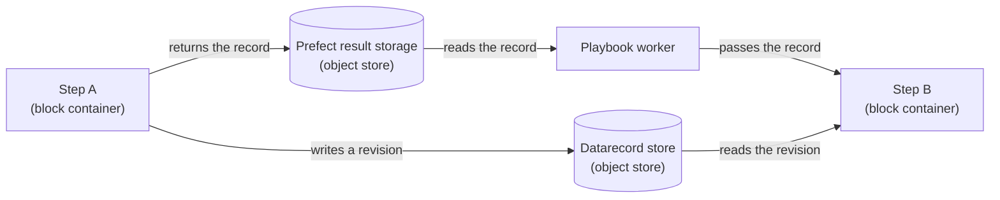

<!--
SPDX-FileCopyrightText: Manta contributors
SPDX-License-Identifier: CC-BY-4.0
-->

# Run lifecycle

This page follows a playbook from the moment its blocks are built into an image to the moment a user reads its result.
It covers what happens before any run, while a user prepares a run, when the run starts, inside each step, and when something fails.
[Architecture](architecture.md#a-run-from-click-to-result) shows the calls of one run as a sequence diagram, and this page explains the reasons behind them.
It assumes you have read [Orchestration with Prefect](orchestration.md) and [Blocks, playbooks and the catalogue](blocks-and-playbooks.md).

## Before any run

Three things have to exist before a run can start, and none of them is on a user's request path.

The first is an image for each block environment.
The one-shot `block-image-builder-pypsa` service builds the image for the `pypsa` environment from `docker/block-image.Dockerfile`.
That image contains `playbook-library`, the environment's own dependencies, Prefect and `runner`.
The `MANTA_ENV_IMAGES` variable maps each environment name to its image.

The second is the work pools, the deployments and the result storage.
The one-shot `playbooks-provision` service runs `python -m runner.deploy`, which creates or updates all of them.
The two workers start once it has finished.

The third is the catalogue.
A block library generates it in the environment that can import its blocks, and `playbook-library` commits it as `catalogue.json`.
The backend reads it from the installed `playbook-library`, and passes it to every run.

Adding a block today therefore means a regenerated catalogue, a rebuilt block image and a backend that runs with the new `playbook-library`.
All three come from the same package in this repository.
[Planned changes](planned-changes.md#block-libraries-outside-this-repository) describes how that is meant to change.

## While a user prepares a run

Nothing runs and no solver starts while a user prepares a run.
The backend serves everything from the catalogue, without importing a block.

`GET /v1/playbooks` lists the playbooks `playbook-library` ships.
`GET /v1/playbooks/{playbook_name}` returns one, with each step's block summary, settings schema, condition and wires, and the default settings.
A form built from a settings schema skips each setting marked `x-manta-input`.

`POST /v1/playbooks/{playbook_name}/validate` checks a set of settings and returns every issue it finds.
It answers with HTTP 200 even when it finds issues, because an editor calls it while the user types and issues are the expected answer.
Each issue names its step path and, where one is at fault, its settings path.
So an editor can mark the right step and the right field.

The web app does not use these endpoints yet: it starts the `expand` playbook with its default settings, as [Start and follow a run](../user-guide/run.md) states.

## When a run starts

`POST /v1/runs` does five things, in this order:

1. It finds the project and refuses a user who does not own it.
2. It finds the playbook by name in `playbook-library`, and takes the playbook's default settings when the request has none.
3. It checks the playbook against the settings, and refuses the run with HTTP 422 and every issue if any are found.
4. It starts a `run-playbook` flow run with the playbook document, the settings, the starting record and the catalogue, without waiting for it.
5. It inserts a `runs` row that links the project and the playbook name to the flow run id.

The request names the starting record itself, as a store URL and a revision uuid.
The backend does not yet look up a project's model for itself.

The playbook travels as its document, not as a name.
So the run uses the playbook as it was at step 4, even if the library changes a second later.
The backend also reads that document back from the flow run to report the run's steps.

After step 5 the backend has no part in the run.
Everything after it happens between Prefect, the two workers and the block containers, and carries on if the backend restarts.

## Where a playbook is checked

Manta checks a run's playbook and settings in three places, each with what it can see:

| Where                      | What it checks against                     | What it can catch                                                                         |
| -------------------------- | ------------------------------------------ | ----------------------------------------------------------------------------------------- |
| The backend                | The catalogue's JSON schemas               | Every structural, wiring, dimension, condition, settings and environment problem          |
| The `run-playbook` flow run | The catalogue it was handed                | The same, before any block container starts                                               |
| The `run-block` flow run   | The block's own settings model             | A record wired to a setting that cannot hold one, and rules the block states in code      |

The backend checks first so that a run which cannot work is refused before anything is queued.
Settings decide which steps run, and so which checks apply.
A check without the run's exact settings could pass a run that then fails, so the backend checks the settings the run carries.

`run-playbook` checks again because `execute_playbook` always checks before it runs anything.
So any caller that dispatches a playbook gets the same check, whether or not it is Manta's backend.
The check reads only data and imports nothing, so repeating it costs almost nothing.

The block's own settings model is the last check, and the only one that sees rules a JSON schema cannot hold.
`cluster_time` needs exactly one of `n_hours` and `segments`, which only its settings model knows.
Everything a JSON schema can state, such as types, required settings and unknown settings, was already checked by the backend.

## Dispatching the steps

The playbook worker picks up the `run-playbook` flow run.
The flow rebuilds the playbook from its document: it parses the JSON, looks up each step's block in the catalogue, and follows nested playbooks.
It imports no block, reads nothing from the object store and loads no modelling framework.
So the runner image stays small, and rebuilding a playbook takes far less time than any step.

For each step that runs under the settings, `execute_playbook`:

1. collects the records that the step's wires point at, from the steps already finished
2. starts a `run-block` flow run with the block's name, the step's settings, the main-line record, the wired records and the image of the block's environment
3. waits for that flow run to end, and takes the record it returns as the next main-line record

The playbook worker keeps a map from step name to the record each step returned.
Wiring a step is a lookup in that map, so the worker passes pointers along and never opens the object store.
It gets no object store credentials in its environment, and reads each returned record through Prefect's result storage.

A nested playbook runs inside the same `run-playbook` flow run.
Its blocks become child flow runs of the top-level run, named after their own steps.

## Inside a block container

The block worker starts a fresh container from the image the flow run names.
This is the first point at which any process imports the block's class, and the only process that can.

`run-block` imports the libraries named in `MANTA_BLOCK_SOURCES` and looks the block up by name.
It fills the wired records into the block's settings, and checks the result against the block's settings model.
It then creates a fresh instance of the block and calls `run` with the input record.
The block reads its input revision from the store, does its work, and writes its result as a new revision.
`run-block` returns the new record, which Prefect writes to result storage on the object store.

The container gets the Prefect API address, the object store address and credentials, and the block libraries to import.
It gets no route to the application database or the identity provider.

## How data moves between steps

Steps run in separate containers, possibly on separate machines, and share no memory and no file system.

Two paths have to work for a step to read the step before it.
The record, a store URL and a revision uuid, goes through Prefect's result storage to the playbook worker, which passes it to the next step.
The model data goes through the datarecord store, written by one container and read by the next.
Both live on the object store, because a shared volume would tie every container to one machine.

## Following a run

`GET /v1/runs/{run_uuid}` returns the state of the run's `run-playbook` flow run.

`GET /v1/runs/{run_uuid}/steps` returns the state of each step.
The backend reads the run's child flow runs from Prefect and matches each to a step by the step name it was started with.
A step that the settings switch off is `SKIPPED`, and a step with no flow run yet is `NOT_STARTED`.
Because each step keeps the name it has in the playbook, a drawing of the playbook can show the state of each step.

`GET /v1/runs/{run_uuid}/logs` returns the log of the `run-playbook` flow run, with the run's state, so a caller knows whether the log is still growing.
Each block's own log stays on its `run-block` flow run, which this endpoint does not read yet.

## When something fails

Each failure stops at a known point, and each has someone who notices it:

| Failure                                       | What happens                                                                                     | Who notices                         |
| --------------------------------------------- | ------------------------------------------------------------------------------------------------ | ----------------------------------- |
| The settings have issues                      | The backend refuses the run with HTTP 422 and every issue, and queues nothing                     | The user, at once                   |
| Prefect is unreachable when a run starts      | `POST /v1/runs` fails, and the backend writes no `runs` row                                       | The user, at once                   |
| The `runs` row cannot be written              | The flow run has already started and runs without a row, and the backend logs it as orphaned      | The operator, from the backend log  |
| A pool has no worker                          | The flow run waits as `PENDING` with no end                                                       | Nobody, unless someone watches the queue |
| A block raises an exception                   | Its `run-block` flow run fails, `PrefectBlockRunner` raises an error naming the step and its flow run, and the playbook run fails | The user, from the run's state and log |
| The playbook worker stops during a run        | The `run-playbook` flow run is expected to crash, and a step it already started to run on without a parent. Nobody has tested this yet | The user, from the run's state      |
| The backend restarts during a run             | Nothing: the run carries on, and the next request reads its state from Prefect                    | Nobody                              |
| A block cannot reach the object store         | The block fails to read or write its record, and its step fails                                  | The user, from the run's state      |

The playbook worker stopping is the failure to design against, because it holds the run for its whole length.
Manta runs it as a long-lived process worker rather than a container per run, which makes that failure rare but not impossible.
[Open questions](open-questions.md#resuming-a-run) asks whether a run should be able to resume from its last finished step.

## What the user sees

The user sees the run at four moments:

- When they start a run, they get HTTP 201 and the run's uuid at once, without waiting for any step.
- While the run is going, they see its state and the state of each step.
- When a step fails, its state names it as the failed step.
- When the run ends, they see its final state, and the result is the last revision in the datarecord store.

The web app today shows the run's state and log only, as [Start and follow a run](../user-guide/run.md) describes.
[Planned changes](planned-changes.md) lists the parts still to come: the log of each step, and the run's result served as a record.

From these stages you can judge where a new kind of failure is caught.
A problem the catalogue can describe is caught before the run starts, and one only the block can see is caught in its container.
