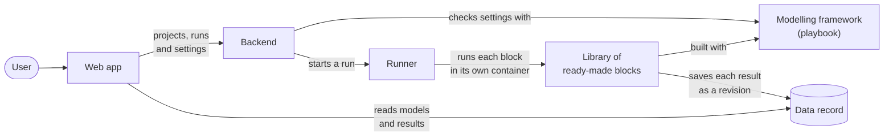

<!--
SPDX-FileCopyrightText: Manta contributors
SPDX-License-Identifier: CC-BY-4.0
-->

# Manta

--8<-- "README.md:docs-preamble"

Manta is a web platform for energy system studies.
A study in Manta is a project.
Its stages are: sign in, open a project, bring in a model, define scenarios, run a playbook, inspect the results, and report on them.
The [user guide](user-guide/index.md) describes each stage and what the web app supports in it.

## The parts of Manta

- The web app is where a user works, at every stage of a project. Today it supports the stages from signing in to Run, some only in part, and the [user guide](user-guide/index.md#what-the-web-app-supports-today) lists what it supports in each stage.
- The backend keeps users, projects, and runs. It checks a playbook's settings before a run and starts each run.
- The modelling framework, `playbook`, sets what a block and a playbook must contain. Modellers use it to write blocks and playbooks, and the backend uses it to check a playbook's settings.
- The library of ready-made blocks contains the blocks and playbooks Manta ships. Its blocks use the open-source [PyPSA](https://pypsa.org) power system modelling tool today, and Manta aims to support other modelling frameworks too.
- The runner runs each block of a playbook in its own container. Each block saves its result as a new revision in the project's [data record](user-guide/concepts.md).

## Where to start

- To learn what Manta is for and why it exists, read [Manta's purpose](user-guide/purpose.md).
- To use the web app as a modeller, read the [user guide](user-guide/index.md).
- To write or run blocks and playbooks, follow [Blocks and playbooks](installation/blocks-and-playbooks.md), then read the [playbook and playbook-library contributing guide](contributing/playbook.md) and the [`playbook` reference](reference/playbook/api.md).
- To work on Manta itself, follow [Full stack](installation/full-stack.md), [Backend](installation/backend.md), or [Frontend](installation/frontend.md). The [technical overview](explanation/architecture.md) shows how the parts fit together, and the [contributing guide](contributing/index.md) sets out how to change them. The [reference](reference/index.md) lists the Python and REST interfaces.
