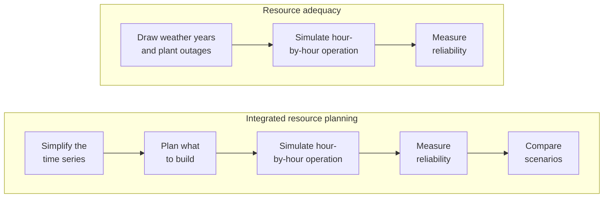

<!--
SPDX-FileCopyrightText: Manta contributors
SPDX-License-Identifier: CC-BY-4.0
-->

# How a study works in Manta

A study in Manta follows one path: start from a model, define scenarios, run a playbook, then read and share the results.
This page explains each part of that path, and shows the kinds of analysis a playbook can run.
[Manta's purpose](purpose.md) explains why Manta is built this way.

!!! warning "Aims, not the state of Manta today"

    This page describes the study path Manta is designed for.
    The [user guide](index.md#what-the-web-app-supports-today) lists what the web app supports today.

## Projects contain everything

A project holds everything about one study in one place.
That includes the model it starts from, the scenarios it tests, every analysis run on them, and the results.
A team works on a project together, and every change and update of its data is kept.
So anyone on the team can see how a result was reached, months after the study ended.

A project can also be shared, and anyone with access to the same tools and data can reproduce it.
When the tools and data are all open source, anyone can reproduce the complete study.

## Models describe the system

A model is a description of an energy system.
It contains the system's network; for example, its power plants and other technologies, their costs, and how demand and weather change over time.

A study starts from a model.
You can bring in an existing model of your own system, a ready-made model, or an example model.
Manta is also designed so that you can build a model in the app, from datasets that are ready to use.

!!! note "Planned for 2027"

    Building a model in the app is planned for 2027.
    Until then, a study starts from an existing model.

## Scenarios are alternative models and futures

A scenario is the model plus a set of changes you want to test.
Examples are a government decision to double the carbon price by 2035, a new interconnector to a neighbouring country, or faster growth in electric heating.

Manta stores each scenario as a set of changes on top of the model, rather than a full copy, so many scenarios take little extra space.
You can compare scenarios side by side, and see exactly which changes each one makes, as well as the impacts on system outcomes.

## Playbooks are analysis templates

A playbook is a template for running an end-to-end analysis.
It links tools that are pre-configured for the standard analysis, only asking for the necessary details of the specific study.
You just pick a playbook, enter your analysis details, and run.

Experienced analysts can also build new playbooks, including iterative or parallel (co-optimisation) workflows.

!!! note "Playbook customisation"

    Playbook customisation will evolve over time. Early releases will ship with a set of built-in playbooks, with the capability for contributors to code new ones.
    A future release (2027+) will include (simple) playbook creation in the UI using plug-and-play blocks.

### Kinds of analysis

Energy system studies fall into a few broad groups.
The examples below show the kind of question each analysis answers.
A single playbook can cover several of them, with different settings.

Planning what to build:

- Integrated resource planning asks which mix of power plants, storage and grid gives a clean system by 2050, at the lowest cost.
- A network development plan asks which grid reinforcements the transmission network needs over the coming decades.

Keeping the lights on:

- Resource adequacy asks whether the planned power plants and grid meet demand in thousands of conditions, such as a cold, windless winter.
- Capacity requirement setting asks how much reliable capacity to procure so that power cuts stay within the national standard.

Policy and markets:

- Policy target setting asks which carbon budget meets a 2040 emissions target, and what that target costs.
- A bidding zone review asks whether splitting or merging electricity market zones would lower system costs and grid congestion.

Running the system day to day:

- Day-ahead operations asks which power plants a utility should run tomorrow, and when.

Testing how robust a result is:

- Sensitivity analysis repeats any other analysis under a change, such as doubled gas prices, and compares the results.

### Blocks are steps of playbooks

A playbook is made of blocks, run in order.
A block is one step of an analysis, such as simulating how the system runs hour by hour.

The same few blocks appear in many playbooks, combined in different ways.
The diagram shows two playbooks from the examples above, and the blocks they share.

Integrated resource planning first decides what to build, then checks that the plan keeps the lights on.
Resource adequacy starts from a system that is already decided, and tests it in many weather years and outage patterns.
Both playbooks use the same blocks to simulate operation and to measure reliability.
So a better block for one step improves every playbook that uses it.

### Playbooks and blocks are configurable

Each playbook has configuration settings that control how it runs, such as which years to plan for or how many weather years to test.
With different settings, one playbook can answer a different question, or the same question under different assumptions.

Manta checks all the settings before a run starts, and lists problems at once.
So a mistake shows up in seconds, not after hours of computing.

## Runs and results

A run is one pass of a playbook over a scenario, with the settings you chose.
Manta runs each block in turn, and keeps the result of every block, not only the last one.
So when a result looks surprising, you can look inside the run and find the step where it changed.

You read the final results as charts and tables, compare runs, and arrange the findings into reports to share.

## Judging a study

With this path in mind, you can judge what a study in Manta shows and how far to trust it.
Each result traces back to a model, a scenario, a playbook and its settings, and every step in between.
