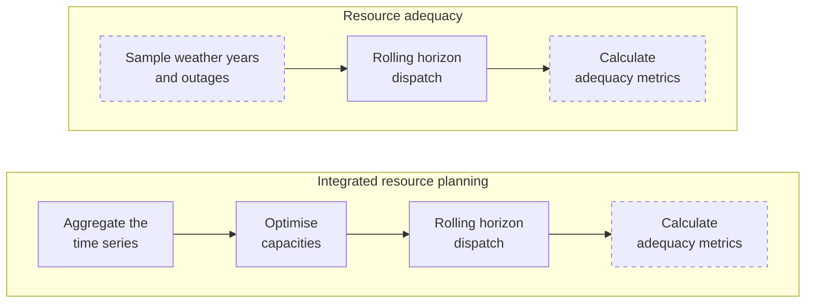

<!--
SPDX-FileCopyrightText: Manta contributors
SPDX-License-Identifier: CC-BY-4.0
-->

# How a project works in Manta

A project in Manta moves through seven stages from signing in to sharing a report.
This page explains each stage, and the kinds of analysis that Manta is designed for.
For why Manta is built this way, see [Manta's purpose](purpose.md).

!!! warning "Manta is still under development"

    Currently, the web app supports only some of the stages on this page, and some of those only in part.
    For what you can do in each stage today, see the [table of stages](index.md#what-the-web-app-supports-today).
    Our goal is a web app that supports all seven stages as this page describes them.

## The stages of a project

The diagram below shows the seven stages, and the layers of data that they add to a project.

--8<-- "docs/user-guide/project-flow.svg"

The top row shows what you do, from left to right.
The bottom part shows the store in which Manta keeps the project's model, scenarios, and results as layers (the [data record](concepts.md)).
A solid arrow marks a stage in which Manta adds a layer.
A dashed arrow marks a stage in which Manta reads the layers beneath it.

In the Run stage, Manta adds one result layer to the data record for each unit of work (a [block](#blocks)) in the analysis workflow (a [playbook](#playbooks)) that you run.
The diagram shows three blocks as an example.
Manta adds each layer on top of the layers before it, so the layers underneath stay as they were.

## Projects

A project is one energy system study.
It contains the model that the study starts from, the scenarios it tests, every run on those scenarios, and the results.
In the first two stages, you sign in, and then you create a project or open one you made before.
Manta keeps every change to the data of a project.

!!! note "Shared projects"

    Currently, a project belongs to the user who created it, so you work on each project on your own.
    We plan to let a team work on a project together, and to let a team share a project with people outside it.
    Milestones [M4](https://github.com/manta-plan/manta/milestone/2) and [M5](https://github.com/manta-plan/manta/milestone/3) track this work.

## Models

A model is a description of an energy system that a solver can optimise.
It contains the network of the system, its technologies and their costs, and its time series, such as demand and weather data.

Every project starts from a model.
You can bring in an existing model of your own system or a ready-made model.
Manta stores the model as the first layer of the project's data record.
In the Model stage, you view the model's network on a map, and you browse its components and their values.

!!! note "Your own models"

    Currently, when you create a project, you pick a ready-made model that an administrator has added to Manta.
    We plan to let you bring in a model of your own.
    We also plan to add a way to build a model in the web app in 2027, from datasets that are ready to use.
    To track our milestones for this, see the [table of stages](index.md#what-the-web-app-supports-today).

!!! note "Supported modelling frameworks"

    Currently, Manta imports only models built with the open-source modelling framework [PyPSA](https://pypsa.org), and the blocks it includes use PyPSA.
    This means that every model you can pick in Manta is a PyPSA model.
    Our goal is to support the most widely used open-source frameworks for capacity expansion, production cost, and eventually power flow modelling.
    We plan to represent the models of every framework in a common schema.
    Milestone [M5](https://github.com/manta-plan/manta/milestone/3) tracks this work.

## Scenarios

A scenario is the model plus a set of changes that you want to test.
Examples are a carbon price that doubles by 2035, a new interconnector to a neighbouring country, or faster growth in electric heating.

You define scenarios in the Model stage.
To define a scenario, you start from an existing one, and then you change values or add components.
You can change a value for one component, or for every component that matches a type, a carrier, or a location.

Manta stores each scenario as layers of changes on top of the model layer (patch layers), and not as a full copy of the model.
To show you the network of a scenario, Manta reads the model layer together with the patch layers of that scenario.
You can compare scenarios side by side, to see which changes each one makes and how those changes affect the results.

## Playbooks

A playbook is a set of blocks chained together into an analysis that you can run.
It has default settings for each of its blocks, so you change only the settings that your study needs.

!!! note "New playbooks"

    Currently, you choose from the playbooks that Manta includes, and a contributor adds a new playbook [in code](../contributing/playbook.md).
    We plan to add a way to build a playbook in the web app from existing blocks, from 2027 onwards.

!!! note "Order of blocks"

    Currently, Manta runs the blocks of a playbook one after another.
    We plan to support playbooks that run blocks in parallel and in loops.

### Kinds of analysis

Energy system studies fall into a few broad groups.
Below are the kinds of studies we are working to support or already support in Manta.
The table lists analyses from each group, and the question that you answer with each one.

| Group              | Analysis                     | Question                                                                                                                       |
| ------------------ | ---------------------------- | ------------------------------------------------------------------------------------------------------------------------------ |
| Capacity planning  | Integrated resource planning | Which mix of generation, storage, and transmission capacity gives a decarbonised system by 2050 at the lowest cost?            |
| Capacity planning  | Network development plan     | Which reinforcements does the transmission network need over the coming decades?                                               |
| Security of supply | Resource adequacy            | Do the planned generation and transmission capacities meet demand in thousands of conditions, such as a cold, windless winter? |
| Security of supply | Capacity requirement setting | How much firm capacity must a system operator procure to keep loss of load within the national reliability standard?           |
| Policy and markets | Policy target setting        | Which carbon budget meets a 2040 emissions target, and what does that target cost?                                             |
| Policy and markets | Bidding zone review          | Would splitting or merging bidding zones lower system costs and grid congestion?                                               |
| Operations         | Day-ahead operations         | Which power plants should a utility run tomorrow, and when?                                                                    |
| Robustness         | Sensitivity analysis         | How do the results of any other analysis change under a change such as doubled gas prices?                                     |

### Blocks

A block is one unit of work in an energy model workflow, such as aggregating the time series of a model or optimising technology capacities.
The same few blocks appear in many playbooks.
The diagram shows an example playbook for each of two analyses in the table, and the blocks that they share.

A solid box is a block that Manta currently includes; a dashed box is a block that isn't included yet.
The example playbook for integrated resource planning first aggregates the time series and optimises capacities.
It then runs a rolling horizon dispatch, to verify that supply meets demand with those capacities.
The example playbook for resource adequacy starts from capacities that are already fixed, and tests them in many weather years and outage patterns.
Both playbooks use the same blocks for the rolling horizon dispatch and for the adequacy metrics.
So a community-manged library of blocks could be used to create any number of playbooks.

### Configuration

Each block has a configuration, which contains the settings of the block, each with its type and its default.
A playbook also has a configuration of its own, such as the investment periods to optimise or the number of weather years to sample.
With different configurations, you can run a different kind of analysis with the same playbook, or the same analysis under different assumptions.

Before a run starts, Manta checks every setting and lists every problem that it finds.
So you can fix a mistake in the configuration before any block runs.

!!! info "See also"

    For what a playbook is made of and how Manta runs one, see [Playbooks and blocks](playbooks.md).

## Runs and results

A run is one pass of a playbook over a scenario, with the configuration settings you chose.
In the Run stage, you pick a playbook and a scenario, adjust the playbook's configuration, and start the run.
While the run is in progress, you follow its status and its log.

Manta runs each block in turn.
Each block reads the layers from preceding blocks (or the initial input) and adds its own result layer on top;
the last block adds the final result layer.
Manta keeps the result layer of every block, so you can inspect the intermediate results of a run.
When a final result is unexpected, you can find the block that caused it.

In the Inspect stage, you read the final result layer of a run.
It is structured just like the Build stage, but now with access to result data.
You can see overviews of your system or drill down to specific points of interest to ensure your results look sensible and to prepare for analysis.

In the Analyse stage, you can communicate model insights in reports.
Your reports contain data as charts and tables, together with headings, text, and images.
Each chart in a report shows the results of the run that you choose for it.
You can also split your report to compare two runs side-by-side.
Once you're ready, you can export the report as a PDF to print or share.

!!! note "Run, Inspect, and Analyse today"

    Currently, a run starts from the input model of the data record, so it leaves out the changes of a scenario.
    We plan for a run to start from the scenario that you pick, and to add the Analyse stages to the web app.
    For the milestones that track this work, see the [table of stages](index.md#what-the-web-app-supports-today).

!!! info "See also"

    To start a run in the web app today, see [Start and follow a run](run.md).

## Tracing a result

With these stages in mind, you can judge what a study in Manta shows and how to verify that your model and analysis is well formulated.
You can trace each result back to a model, a scenario, a playbook and its settings, and the result of every block in between.
Two parts of Manta's design make this possible:

- Manta keeps the model, each scenario, and the result of every block as separate layers of the data record.
  So every state that the study passed through is still there to read.
- Manta is open source, and so are the modelling tools that its blocks use.
  Anyone can read how a block computes its result.

So anyone with access to a project can see how the study reached a result, long after the study has ended.

!!! note "Reproducing a study"

    Currently, Manta records the playbook and the settings of each run, and not the version of each tool that its blocks used.
    This means that you can trace a result to its playbook and its settings.
    To reproduce the study, you need the tool versions from outside Manta.
    We plan for a run to record the version of each tool as well.
    Anyone with access to the same tools and data can then reproduce the study.
    Milestone [M4](https://github.com/manta-plan/manta/milestone/2) tracks this work.
