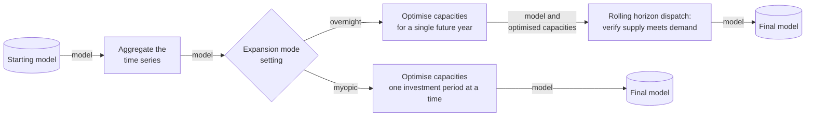
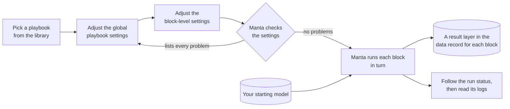

<!--
SPDX-FileCopyrightText: Manta contributors
SPDX-License-Identifier: CC-BY-4.0
-->

# Playbooks and blocks

A playbook is a ready-made sequence of modelling steps, which Manta runs on a model in the Run stage.
With a playbook you can formulate an analysis of your energy system without writing model code.

## What a playbook is made of

A **block** is one piece of modelling work on an energy model, such as aggregating its time series or optimising future technology capacities.
A **playbook** is a set of blocks in a fixed order, together with default settings for each of them.
Each block takes the model the previous block produced and does its work.
It then passes a new version of the model to the next block, or back to the app.
A setting can switch a block on or off, so one playbook can cover several ways of running a study.

Manta ships with the `cluster-expand-dispatch` playbook.
It aggregates the time series, optimises capacity expansion decisions, and then runs a rolling horizon dispatch optimisation to verify them.

The diagram follows the model through the playbook from left to right.
First, the playbook aggregates the model's time series, so that the chosen capacity expansion block can solve a smaller model.
The expansion mode setting then picks one of two blocks that optimise technology capacities.
With the overnight mode, the playbook treats the whole study period as one moment in time; i.e., an end-state or greenfield model run.
It then passes the optimised capacities to the rolling horizon dispatch block.
With the myopic mode, it optimises capacities one investment period at a time.
The investment decisions from one period inform the starting conditions for the next.
The playbook ends there, because the dispatch block runs only with the overnight mode.
The default settings group the time series into even three-hour blocks and use the overnight mode.

Manta also ships the `expand` playbook, which only runs the capacity expansion step.
It is used for testing and should only be run on a small model as it has no time aggregation step.
Its expansion mode setting picks the overnight mode, the myopic mode, or a perfect foresight mode that plans all investment periods together.
The default is the overnight mode.

## How Manta runs a playbook

You start a run from a playbook and its default settings.
You adjust the settings, Manta checks them, and then runs the blocks on your starting model one after another.

The diagram reads from left to right.
You pick a playbook and adjust its settings, starting from global playbook settings and then continuing to block-level settings.
If Manta finds a problem with the settings, it will list every problem at once before running, so you go back and change them.
Once the settings have no problems, Manta runs each block of the playbook on your starting model, in order.
Each block adds a result layer to the data record, on top of the layer it started from.
So the intermediate models of a run are always available.
You can follow the run status while it is running and read its logs when it has finished.

The web app supports part of this flow today; [start and follow a run](run.md) describes which part.
