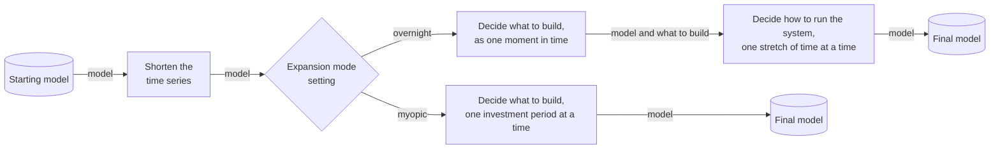
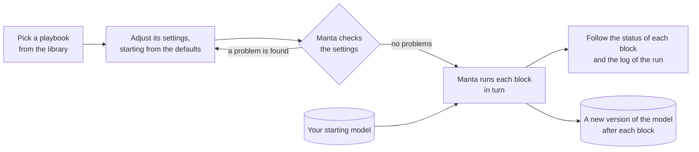

<!--
SPDX-FileCopyrightText: Manta contributors
SPDX-License-Identifier: CC-BY-4.0
-->

# Playbooks and blocks

A playbook is a ready-made sequence of modelling steps, which Manta runs on a model in the Run stage.
With a playbook you can ask what to build and how to run the system without writing model code.

## What a playbook is made of

A **block** is one piece of modelling work on an energy model, such as shortening its time series or deciding what to build.
A **playbook** is a set of blocks in a fixed order, together with default settings for each of them.
Each block takes the model the previous block produced, does its work, and passes on a new version of the model.
A setting can switch a block on or off, so one playbook can cover several ways of running a study.

Manta ships the `cluster-expand-dispatch` playbook, which shortens the time series, decides what to build, and then decides how to run the system.

The diagram follows the model through the playbook from left to right.
First, the playbook shortens the model's time series, so that later blocks have less to solve.
The expansion mode setting then picks one of two blocks that decide what to build.
With the overnight mode, the playbook treats the whole study period as one moment in time.
It then decides how to run the system with what it chose to build.
With the myopic mode, it decides what to build one investment period at a time, and the playbook ends there without the last block.
The default settings group the time series into even three-hour blocks and use the overnight mode.

Manta also ships the `expand` playbook, which only decides what to build.
Its expansion mode setting picks the overnight mode, the myopic mode, or a perfect foresight mode that plans all investment periods together.
The default is the overnight mode.

## How Manta runs a playbook

You start a run from a playbook and its default settings.
You adjust the settings, Manta checks them, and then runs the blocks on your starting model one after another.

The diagram reads from left to right.
You pick a playbook and adjust its settings.
If Manta finds a problem with the settings, it lists every problem at once and runs nothing, so you go back and change them.
Once the settings have no problems, Manta runs each block of the playbook on your starting model, in order.
Each block adds a result layer to the data record, on top of the layer it started from.
So the model after every block stays available.
While the run goes on and after it ends, you can follow its status and read its log.

The web app supports part of this flow today, and [Start and follow a run](run.md) describes which part.
